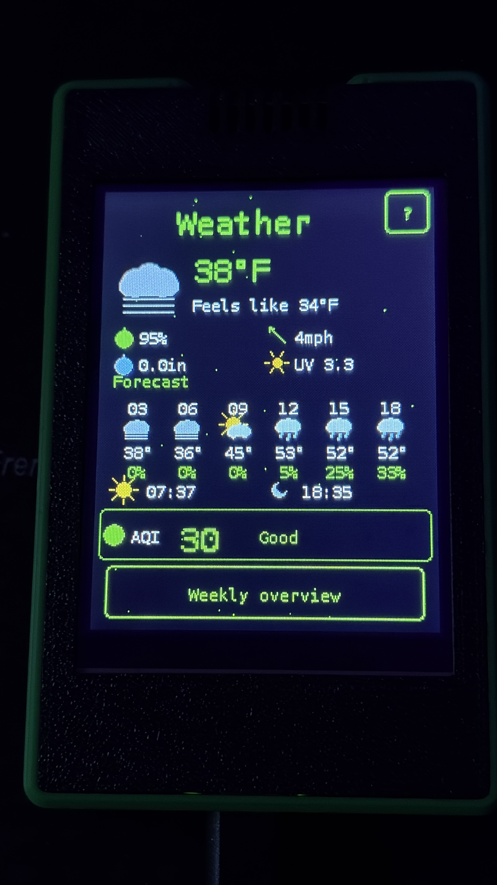

# Eiswolfs Toolbox

A multi-screen info dashboard running on the ESP32 "Cheap Yellow Display" (CYD,
ESP32-2432S028) — ISS tracking, weather, crypto prices, earthquakes, a
calendar, and more, all on one small touchscreen device you can leave running
on a shelf or desk. It's completely free to use: no account, no API keys, no
subscription for any feature — every data source it talks to is a free,
public API.

## Getting Started

You can flash the firmware directly from your browser to your CYD display without installing any development tools — just open the [Web Flasher](https://eiswolf-bg.github.io/eiswolfs-toolbox/) (requires Chrome, Edge, or Opera).

### Option 1: Quick Web Installation (Recommended)
1. Connect your "Cheap Yellow Display" to your computer using a USB cable.
2. Click the **Web Flasher link above**.
3. Click the **Install** button on the web page, select your USB/COM port, and follow the instructions.

**Driver note:** If your computer doesn't detect the CYD (no USB/COM port shows up), you likely need to install a driver for the board's CH340 USB-to-serial chip first:
- **Windows:** [CH341SER.EXE](https://www.wch-ic.com/downloads/CH341SER_EXE.html)
- **macOS:** [CH341SER_MAC.ZIP](https://www.wch-ic.com/downloads/CH341SER_MAC_ZIP.html)
- **Linux:** built into the kernel since version 5.x - no separate installation needed

### Option 2: Manual Compilation (For Developers)
1. Open and compile the project using PlatformIO (`platform = espressif32`, `board = esp32dev`, `framework = arduino`).
2. Insert a FAT32-formatted microSD card into your display (used to store your settings, WiFi credentials, and calendar appointments).
3. On first boot: calibrate the touchscreen and configure your WiFi and location via the built-in on-screen keyboard.

---

## Usage

The controls are kept deliberately simple:

- **Swipe left/right** to switch between the individual info screens (the
  "carousel").
- **Swipe up/down** from any screen to open the Settings menu — from
  there you can adjust language, location, units (metric/imperial), WiFi,
  and screen-specific options.

## Screens

- **🌦️ Weather** — current temperature plus "feels like", an hourly
  short-term preview and a weekly overview, precipitation, wind speed,
  and UV index, along with air quality (AQI) and its category (e.g.
  "Good"). Sunrise and sunset times are shown as well.
- **🗓️ Calendar** — shows the current month including country-specific
  public holidays. You can add your own appointments directly on the
  device, including a time and an optional reminder that blinks the LED
  when it's due — regardless of which screen is currently active.
- **🌋 Natural Events** — currently active natural events worldwide
  (volcanoes, severe storms, floods, landslides), based on NASA EONET.
  Wildfires are deliberately excluded, since they alone would account for
  thousands of small individual events.
- **🛰️ ISS Radar** — the current position of the International Space
  Station on a dotted world map, including distance, altitude, speed, and
  whether it's currently visible above the horizon.
- **🚀 Rocket Launch** — a countdown to the next upcoming orbital launch
  worldwide, with mission, rocket, agency, and launch site; an LED can
  automatically blink in the final minutes before liftoff.
- **🚌 Transit Departures** — real-time departures from the nearest public
  transit stop, including line, direction, and minutes remaining.
- **🏎️ Formula 1** — a countdown to the next race weekend along with the
  circuit location and the current driver standings (top 3).
- **💰 Crypto Ticker** — current Bitcoin and Ethereum prices in a
  currency of your choice, plus mempool status and the crypto market's
  Fear & Greed index.
- **🌍 Earthquakes Worldwide** — the currently strongest recorded
  earthquake highlighted front and center, with magnitude, location,
  depth, and time, followed by a list of further recent earthquakes.

**Eiswolfs Toolbox keeps growing with more screens over time** — the
project is actively in development, with plenty more planned.

---

## Technical Notes

- **Hardware:** ESP32-2432S028 "Cheap Yellow Display" (CYD), 240×320
  touch TFT.
- **Languages:** The interface is fully available in German, English,
  Spanish, and French, switchable directly on the device.
- **SD card:** A FAT32-formatted microSD card is required to persist
  settings, WiFi credentials, and calendar appointments.
- Every data source used is a free, public API — no account or API key
  is ever needed.
