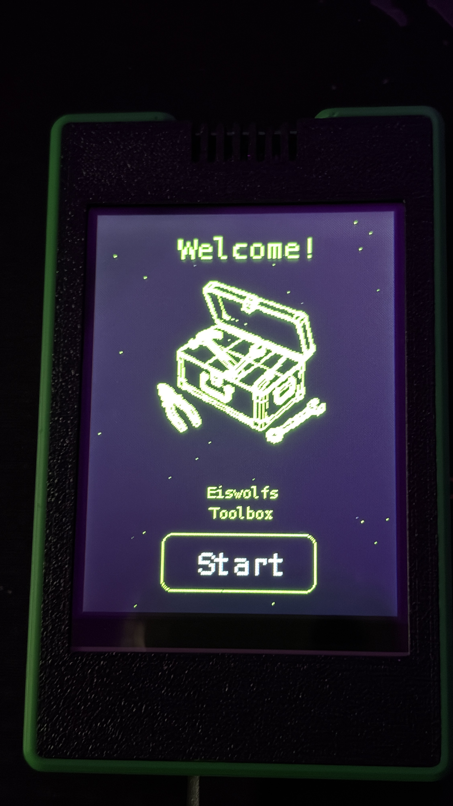
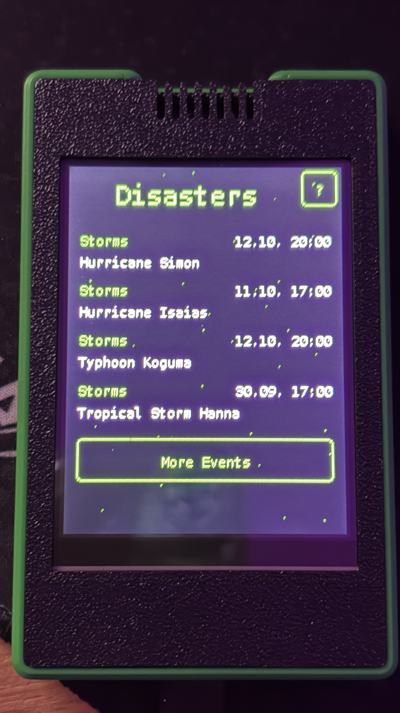
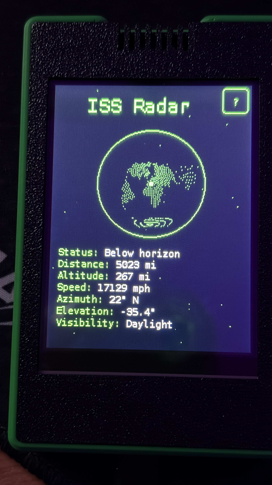
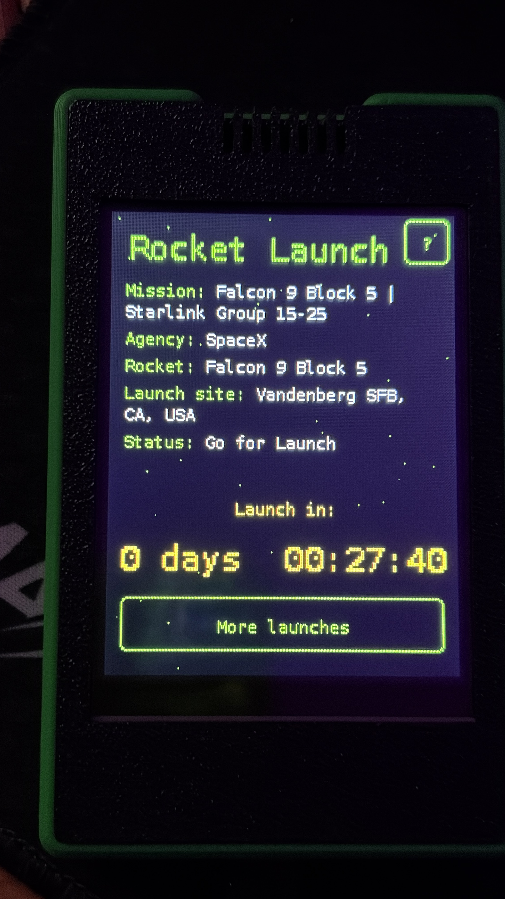
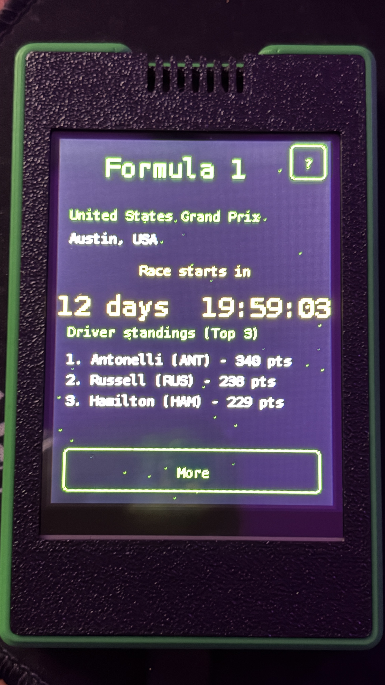
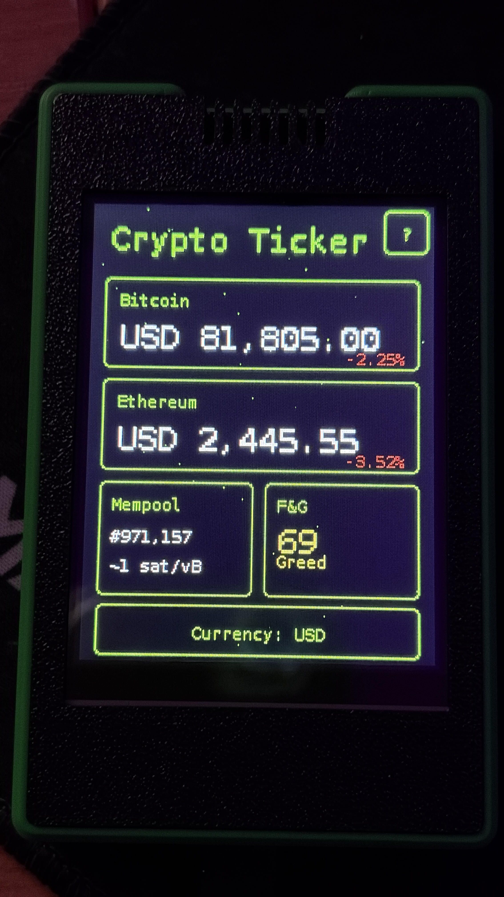
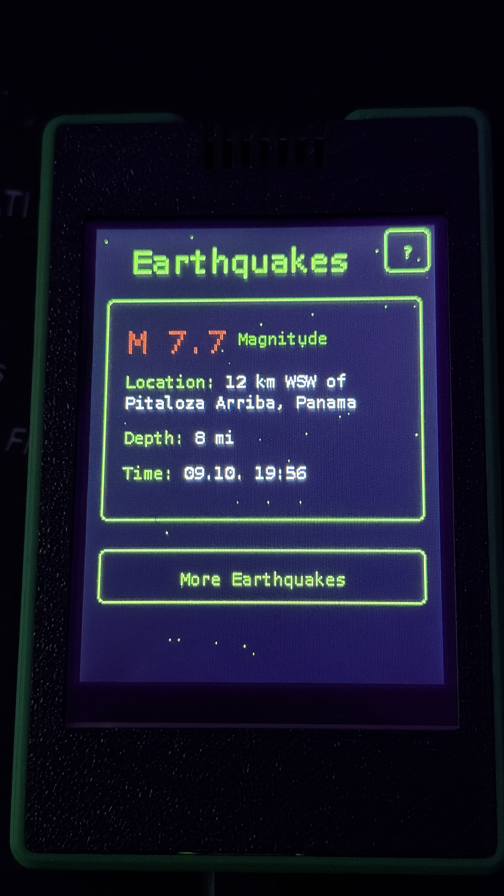
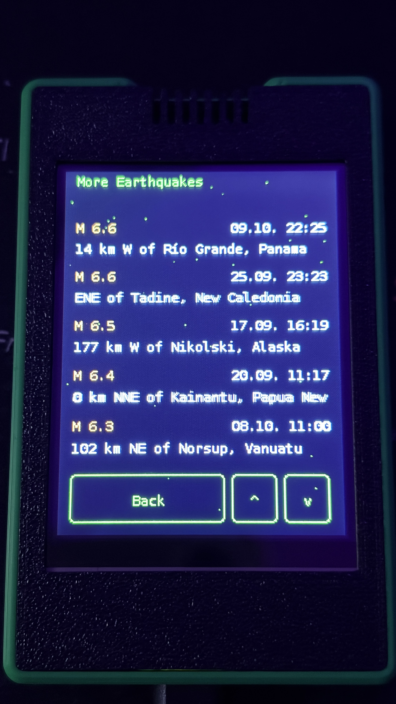

# 📷 Photo Gallery

A few more photos of Eiswolfs Toolbox in action.

[← Back to README](../README.md)

---

**Welcome screen** – greets you on first boot, before the guided setup.

---

**Natural Events** – active storms and other events worldwide, courtesy of NASA EONET.

---

**ISS Radar** – live position, distance, altitude, and visibility of the International Space Station.

---

**Rocket Launch** – countdown to the next upcoming orbital launch, with mission details.

---

**Formula 1** – countdown to the next Grand Prix plus the current driver standings.

---

**Crypto Ticker** – Bitcoin and Ethereum prices, mempool status, and the Fear & Greed index.

---

**Earthquakes** – the latest significant earthquake worldwide, highlighted front and center.

---

**More Earthquakes** – a scrollable list of further recent earthquakes.
